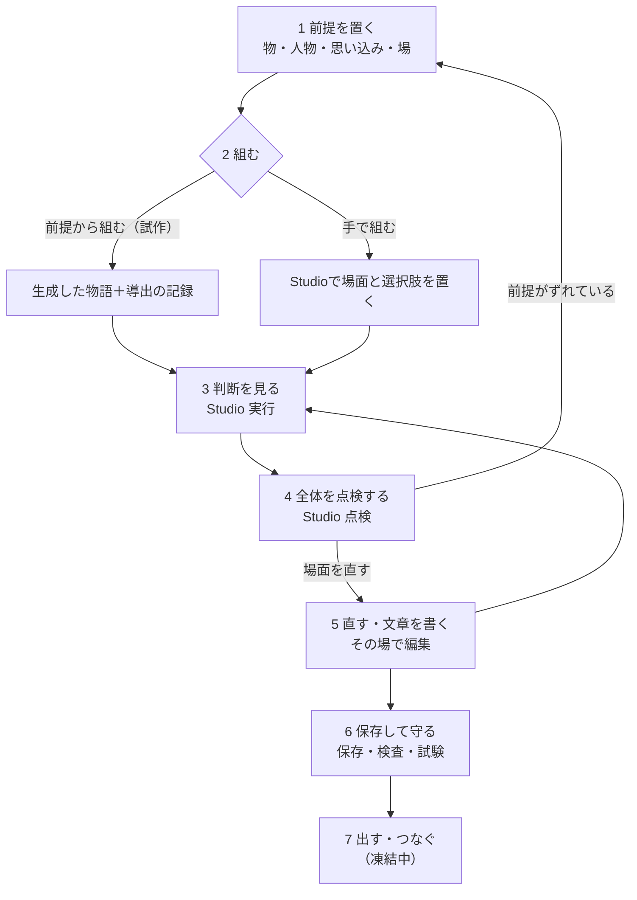

# SP-PIPE-001: 制作ワークフロー

**ステータス**: done（ワークフローの定義。各工程の道具の状態は下の表）
**作成日**: 2026-03-23 / **体系化**: 2026-11-22
**カテゴリ**: system

## 目的

NarrativeGenで物語を作る時に、誰が・何を・どの順で・どの道具で行うかを一つにまとめる。
2026-11-22のuser依頼「このプロジェクトの構築しようとしている開発ワークフローを体系化したい」に基づく。
この「開発ワークフロー」が物語を作る工程を指すことは、同日userが確認した（問い「物語を作る工程の意味で合っていますか」に「合っている」）。
2026-11-21の再構築（Studioが主画面、ゲーム層は凍結）と、前提から物語を組む試作（[SP-PREMISE-001](premise-driven-story.md)）を反映した。
旧版（Web Tester中心の5ステージ）はGit履歴にある。

## 考え方

作者は世界を定義し、エンジンが帰結を導き、作者がその判断を見て直す。場面を一つずつつなぐ作業を減らし、
「なぜそうなったか」を画面で確かめながら進める。決める主体は4つに分ける。

| 主体 | 決めること | 決めないこと |
|---|---|---|
| 人（作者） | 物・人物・思い込み・場・意図、文章、採否、表現 | — |
| エンジン（必然） | 違和感の有無、出来事、文章の展開、選択肢の開閉、物語全体の点検 | 何を物語にするか |
| 生成器（蓋然・試作） | 前提から起こりうる展開とその割合、意図に合う主線 | 文章、前提の中身 |
| AI（開発担当） | 制作システムの実装・検査・文書、比較材料の用意 | 物語の文章、表現の採否 |

1人運用で、ライター／テクニカルデザイナー／インテグレーターは帽子の切替（2026-03-27の確認結果を維持）。

## 全体の流れ

図は工程の順と戻り先を表す。ひし形は組み方の分岐、点検からの2本の矢印は直す場所の違い（前提か場面か）。
5から3へ戻る輪が日常の作業で、1へ戻るのは世界の定義を変える時。

## 工程

| # | 工程 | 人がすること | 機械がすること | 道具・入口 | 成果物 | 状態 |
|---|---|---|---|---|---|---|
| 1 | 前提を置く | 物と性質、人物の知識、思い込み、場、（任意で）意図を書く | 形の検査（生成時） | `models/premises/*.json`を手書き。物・人物は既存モデルならStudioの「人物と物」 | 前提ファイル、またはモデル内の定義 | 前提ファイルは試作（画面なし） |
| 2a | 前提から組む | 生成を実行し、導出の記録を読む | 違和感の判定、展開の列挙、主線の選別、モデルの組み立て | `npm run generate:story -- models/premises/<名前>.json` | `models/generated/<名前>.json`、導出の記録 | 試作 |
| 2b | 手で組む | 場面・選択肢・行き先・条件・効果を置く | 条件と効果の検査 | Studio「この場面を編集」 | `models/examples/*.json` | 使える |
| 3 | 判断を見る | 物語を進め、右列の判断を読む | 知覚・状態の変化・本文の組み立て・選択肢の開閉の記録 | `npm run dev:studio` → 実行 | —（確認） | 使える |
| 4 | 全体を点検する | 結末・行き止まり・開かない選択肢を読み、直す場所を決める | 開いている選択肢をすべて実際に選んで調べる | Studio 点検 | —（確認） | 使える（数値が増え続ける物語は状態数2000で打ち切り） |
| 5 | 直す・文章を書く | 本文・選択肢・条件・知識ルール・人物と物を直す。骨子文を自分の文章にする | 変更のたびに同じ道筋を再トレース | Studio「その場で編集」 | 編集中のモデル | 本文・条件・定義は使える。会話テンプレート・言い換え辞書・経過数の編集は未対応 |
| 6 | 保存して守る | 保存を押す。コミットする | `loadModel`の検査、保存前の点検、試験 | Studio 保存、`npm run check:safety`、`npm run test:engine` | 元のJSON | 使える |
| 7 | 出す・つなぐ | 出力形式を選び、ランタイムへ置く | 変換、SDKでの実行 | 旧Web Testerの出力（JSON/CSV/Yarn/Ink/Twine）、Unity SDK | 各ランタイム用ファイル | 凍結（再構築の区切りでuserが再開を決める） |

### 2aと2bの使い分け

- 2a（前提から組む）: 世界の定義から何が起こるかを先に見たい時。前提の数値を変えて結末の割合を比べられる。
  出来上がるのは骨子文の物語で、文章は5で書く。
- 2b（手で組む）: 決まった筋を書く時、または2aの生成物を土台に育てる時。
- 生成物を手で直すと、前提からの再生成と食い違う。直して育てる物語は`models/examples/`へ写す運用を想定している（未決。SP-PREMISE-001 6節）。

### 直す場所の決め方

| 見えたこと | 直す場所 | 戻る工程 |
|---|---|---|
| 違和感が起きるはずの人物に起きない／起きないはずなのに起きる | 見込み、許容幅、物の性質 | 1（2aなら組み直し、2bならStudioの知識ルール・人物と物） |
| 結末の割合が意図と違う（生成） | 人物の知識の正確さ、場にいる人物、意図 | 1 |
| 行き止まり、開かない選択肢、解決できない参照 | 条件・効果・行き先 | 5 |
| 文章が骨子のまま、言い回しが合わない | 本文、骨子文の型 | 5 |

## 手動と自動の境界

- 人だけが行う: 前提の中身を決めること、文章を書くこと、物語と表現の採否、ゲーム層の再開の判断。
- 機械が行う: 違和感の判定、展開の列挙と割合、点検、検査、試験。
- 構想（旧Stage 1）へのAI支援はスコープ外という2026-03-27の確認結果は変えていない。2aは規則と前提の数値だけで組み、
  LLMを使わないが、物語の構造を機械が組む点で「構想は100%手動」とした旧定義と異なる。この扱いはuserの判断待ち。

## 現在の不足

| 不足 | 影響 | 次の一手 |
|---|---|---|
| 前提を書く画面が無い（JSON手書き） | 1の手間が大きく、数値を変えて比べる往復が遅い | 2aの方式の採否が決まってから、Studioに前提の画面を置くかを決める |
| 蓋然と理由がStudioの右列に出ない | 3で「なぜこの展開か」を見るのに導出の記録を別に開く | 同上 |
| 生成物を直した後の扱いが未決 | 2aと5を行き来すると食い違う | userが運用を決める |
| 会話テンプレート・言い換え辞書を編集できない | 5で差し込み文と言い換えを直せない | Studio編集の受入の後 |
| 7が凍結中 | 作った物語をゲームへ渡す経路を今は使わない | 再構築の区切りでuserが再開を決める |
| WritingPage連携は延期中 | 長文の執筆をStudio内で行う | 着手条件は[writingpage-io-contract.md](writingpage-io-contract.md) |

## HUMAN_AUTHORITY 確認結果（2026-03-27、変更なし）

| # | 項目 | 決定 | 備考 |
|---|------|------|------|
| 1 | ペルソナの妥当性 | **1人運用** | P1/P2/P3 は「帽子の切替」。3分類は設計上の関心分離として維持 |
| 2 | WritingPage 連携の優先度 | **延期 (WritingPage 安定待ち)** | 次スライス候補として維持 (2026-04-03) |
| 3 | エクスポート戦略 | **JSON 主軸** | 独自機能が活きるのは JSON + 独自ランタイムのみ。他形式は互換用 |
| 4 | Stage 1 AI 支援 | **スコープ外** | 構想は人間の仕事。2aの試作との関係はuserの判断待ち（上記） |
| 5 | Pipeline ガイドの形態 | **AUTHORING_GUIDE 拡張** | `docs/AUTHORING_GUIDE.md`は旧Web Tester中心の記述のまま（未更新） |

## 関連仕様

- [SP-STUDIO-001](studio-rebuild.md): 工程3〜6の画面と判断の記録
- [SP-PREMISE-001](premise-driven-story.md): 工程1・2aの方法と試作
- SP-KNOW-001 / SP-KNOW-002 / SP-ANOMALY-001 / SP-EVENT-001: 必然の段（知識・違和感・出来事）
- SP-TGEN-001 / SP-TEXT-001 / SP-DYNAMIC-001: 文章の展開と差し込み
- SP-SCHEMA-001 / SP-ENGINE-001: モデルの形と実行
- SP-EXP-YARN-001 / SP-UNITY-001: 工程7（凍結中）
