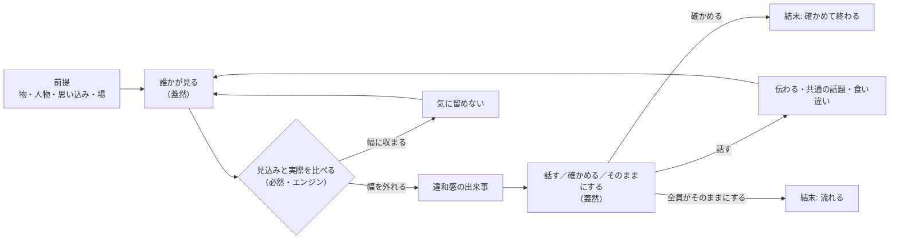

# SP-PREMISE-001: 前提から物語を組む

**Status**: partial（方式は2026-11-22にuserが採用。行為の種類は直す向きの回答待ち） | **Cat**: core

## 1. 目的

2026-11-22のuser依頼（原文）:

- 「このプロジェクトが実現しようとしているストーリー構築方法についてより具体化したい。」
- 「前提をいくつか与えただけで蓋然的にストーリーが構築できるシステムのプロトタイプを構築したい。」

これまでのサンプルは、場面と選択肢を人が一つずつつないでいた。この仕様は、物・人物・思い込み・場という少数の前提から、
出来事の連なりをエンジンと生成器が導く方法を定める。原初設計の目標「論理的に破綻しない、無数のストーリーバリエーションの
自動生成」と、5.1 違和感検出 → 5.2 事象Entityの生成 → 5.3 動的ストーリー展開（Git履歴
`58af830^:docs/archive/legacy-specs/ORIGINAL_DESIGN_PHILOSOPHY.md`）を、動く形にする。

LLMは使わない。前提の数値と固定の規則だけで組み、同じ前提からは同じ物語が出る。

## 2. 物語の構築方法

物語は「必然の段」と「蓋然の段」を交互に進めて組む。



図は前提から結末までの流れを表す。ひし形はエンジンが決定論で決める判定、「（蓋然）」の箱は重みで選ばれる行為。
違和感が一度も生まれなければ結末は「誰も気づかない」になる。

### 2.1 前提（人が与えるもの）

| 前提 | 中身 | 形 |
|---|---|---|
| 物 | 名前、親（継承）、性質と値 | モデルの`entities`と同じ |
| 人物 | 名前、知識の分野ごとの正確さと許容幅 | モデルの`characters`と同じ |
| 思い込み | 人物が、ある物の性質をいくつと見込んでいるか（分野つき） | モデルの`knowledgeRules`と同じ項目 |
| 場 | 誰がいて、目の前に何があるか | `scene.present`・`scene.focus` |
| 意図（任意） | 物語に含めたい出来事の種類、結末 | `intent.include`・`intent.ending` |

### 2.2 必然の段（エンジンが決める）

人物が物を見ると、エンジンの`perceiveEntity`が見込みと実際の値を比べる。許容の幅は「見込み × 許容幅」、
ずれは「|実際 − 見込み| ÷ 幅」。ずれが1を超えると違和感になり、出来事（事象Entity）が生まれる。
出来事の強さは実行時と同じ`min(100, round(ずれの合計 × 20))`。生成器はこの判定を作らず、読むだけ。

### 2.3 蓋然の段（重みで選ばれる行為）

その時点で可能な行為それぞれに重みを付け、重みの合計に対する割合を蓋然とする。重みは前提の数値だけから作る。

| 行為 | できる条件 | 重み | 起きること |
|---|---|---|---|
| 見る | まだ見ていない | 知識の正確さ（誰かに話を聞いた後は、話した人の違和感の強さを足す） | 必然の段へ。違和感を覚えるか、気に留めない |
| 話す | 違和感を抱えている。相手にまだ話していない | 違和感の強さ ÷ まだ話していない相手の数 | 相手がまだ見ていない→伝わる／相手も違和感→共通の話題／相手は気に留めなかった→食い違い |
| 確かめる | 違和感を抱えている | 違和感の強さ × 知識の正確さ | 実際の値が事実として確かめられ、物語が終わる |
| そのままにする | 違和感を抱えている | (1 − 違和感の強さ) × (1 − 知識の正確さ) | その人物の違和感が閉じる |

重みの式はuserが採用した（4節）。行為の種類は「直す」の回答で、直す向きを聞いている（4節）。

違和感の強さは出来事の強さを100で割った値。可能な行為が無くなった時が結末で、3種ある:
確かめて終わる／確かめられないまま流れる／誰も気づかない。

### 2.4 選別（どの展開を物語にするか）

可能な展開をすべて数え、次を出す。

- 結末の割合: この前提から起こりうる展開が、どの結末にどれだけ行き着くか。
- 意図を満たす割合: 意図に挙げた出来事をすべて含む展開が、全体のどれだけか。
- 主線: 意図を満たす展開のうち最も蓋然なもの1本。意図が無ければ全体で最も蓋然な1本。`--seed`を付けると、重みに従って引いた別の1本。

意図を満たす展開が無い時は、その旨を警告し、意図なしの主線を出す。違和感が生まれない前提では「この前提からは出来事が起きない」と
人物ごとの見込み・幅・実際の表を返す。どちらも、前提のどこを直せばよいかを作者が読むための結果。

### 2.5 文章

生成器は骨子文（何が起きたかだけを述べる固定の型）を置く。値は`[物.性質]`・`[出来事.性質]`の参照にし、
実行時にエンジンが展開する。作者は`wording.patterns`で型を、生成後はStudioで本文を自分の文章へ置き換える。
骨子文の初期値は`premise-story.ts`の`DEFAULT_PATTERNS`にあり、assistantが書いた文面をuserが採用した（4節）。何が起きたかを述べる型で、作品の文章は作者が置き換える。

### 2.6 原初設計・現行エンジンとの対応

| 原初設計 | 現行エンジン | この試作での扱い |
|---|---|---|
| 5.1 プロパティ比較による違和感検出 | `detectAnomaly`・`perceiveEntity` | 必然の段でそのまま使う |
| 5.2 事象Entityの生成 | `createPerceptionEvent`・`createEvent` | 違和感・話した・確かめた・そのままにした、を出来事にする |
| 5.3 動的ストーリー展開（共通話題の発見ほか） | 会話テンプレート（人が発火条件を書く） | 「話す」の結果として共通の話題・食い違いを導く |
| 1.2 階層的プロパティ継承 | `resolveProperty` | 前提の物は親をたどって値を解決する |
| 3 構文ベース生成 | `expandTemplate` | 骨子文の参照を実行時に展開する |
| 2 入れ子構造（章・節・段落） | なし | 未対応（場は1つ） |

## 3. 試作の契約

- 入口: `generateStory(premise, options)` と `describeDerivation(premise, derivation)`（`packages/engine-ts/src/premise-story.ts`、
  `index.ts`・`browser.ts`から公開）。実行時の意味論（`session-ops`ほか）は変えていない。
- 出力: 通常のモデル（`loadModel`の検査を通る）と、導出の記録（人物ごとの判定、主線の各手の蓋然と理由、他に起こりえた行為、
  結末の割合、使えなかった前提）。
- 生成したモデルの「見る」は`perceiveEntity`の効果、他は`createEvent`の効果。話す・確かめる・そのままにするの選択肢には
  「その人物の違和感の出来事が起きている」条件が付く。再生時にエンジンが違和感を計算し直すので、Studioで見込みを変えると
  選択肢が閉じ、点検に行き止まりが出る。その時は前提を直して組み直す。
- 主線の各場面には、蓋然が10%以上の別の行為を2つまで残す。脇道は最も蓋然な行為だけで結末まで進む。
- 決定性: 同じ前提と同じ`seed`からは同じ結果。

```powershell
npm run generate:story -- models/premises/cheeseburger-weight.json --report docs/samples/premise-story-cheeseburger-weight-review-ja.md
```

`models/generated/<名前>.json`へ書き出し、Studioの物語選択に「<名前>（前提から生成）」として出る。
`--seed <整数>`で別の展開、`--no-write`で画面表示だけ、`--out <パス>`で書き出し先を変える。

見本: [前提](../../models/premises/cheeseburger-weight.json) → [生成した物語](../../models/generated/cheeseburger-weight.json)、
[導出の記録](../samples/premise-story-cheeseburger-weight-review-ja.md)。前提の中身（携帯食料→チーズバーガー→誰かが食べていた
チーズバーガー、重さ0.1の見込みと0.12の実際、探偵A・目撃者B・酔った人の知識）は原初設計メモの例から取った。
試験は`packages/engine-ts/test/premise-story.spec.ts`（生成物を実行時に再生し、予測と一致することを含む）。

## 4. 採否（2026-11-22、userの回答）

Recordinatorの問い `01M81SKWBNW29HPMMM91R44J0A`（Project `pc96190c8a9`）への回答。

| 項目 | 回答 | 扱い |
|---|---|---|
| 行為を「見る・話す・確かめる・そのままにする」の4種にしたこと | 直す（メモなし） | 直す向きを問い `01M81TNDSDKW3DMTH8MN8CXVJ5` で聞いている。回答まで今の4種で動かす |
| 2.3の重みの式と、知識の正確さ（`accuracy`）を「よく見る・確かめる度合い」に使うこと | 採る | 仕様とする。現行エンジンの違和感の判定は`accuracy`を使わないままにする |
| 意図の語彙（出来事7種・結末3種）と、見本の意図（共通の話題・食い違い） | 採る | 仕様とする。行為が増えた時は語彙を足す |
| 骨子文の文面と、選択肢に出す蓋然の数値 | 採る | 仕様とする |
| 生成物の置き場（`models/generated/`）とStudioの物語選択への追加 | 採る | 仕様とする |
| 「構想は人の仕事」との関係 | 規則と数値による組み立ては認める | 前提からの組み立ては製品の機能とする。LLMによる構想支援は入れていない（[REPO_LOCAL_RULES](../REPO_LOCAL_RULES.md)） |
| 次に作るもの | 実行画面の右列に蓋然と理由を出す | 4.1節 |
| 生成した物語を手で直した後 | 育てる物語は`models/examples/`へ写す | 4.2節 |

### 4.1 実行画面の右列（蓋然と理由）

導出の記録（`StoryDerivation.scenes`）は、場面ごとに、その場面で可能だった行為・重み・蓋然・重みの内訳・選択肢に残した行為・主線が選んだ行為を持つ。
Studioは`models/generated/`の物語を開いた時、同じ名前の前提（`models/premises/`）からエンジンの`generateStory`で導出を作り、右列の先頭に描く。
モデルの形（スキーマ）は変えていない。文面はエンジンの`explainAction`・`endingLabel`・`beatLabel`が返し、Studioは蓋然の計算も文面の組み立ても持たない。
保存されている物語が今の前提から組んだものと違う時は、導出を出さずにその旨を出す。

### 4.2 写して育てる

`models/generated/`の物語は、Studioでは保存の代わりに「写して育てる」を出す。押すと`models/examples/`へ別名で書き出し、以後はその写しを編集する。
写しは前提とのつながりを持たず、右列の蓋然の欄は出ない。選択肢の文の〔蓋然 N%〕も写す時に外す（手で直した後は数値が合わなくなるため）。
旧Web Testerの見本置き場（`apps/web-tester/models/examples/`）にも同じファイルを置く（`check:models-sync`が比べるため）。
生成した物語をStudioで直している間は、蓋然の欄に「前提から組んだ物語と違っています」と出る。

## 5. 調査（2026-11-22確認）

| 問い | 開いた資料 | 計画に反映した点 |
|---|---|---|
| 思い込みと事実のずれから物語を導く先行例は、必ず起きることと選べることをどう分けるか | Ware & Siler「Sabre: A Narrative Planner Supporting Intention and Deep Theory of Mind」AIIDE 2021（[論文PDF](https://cs.uky.edu/~sgware/reading/papers/ware2021sabre.pdf)） | 行為（選ばれる）とtrigger（条件が揃えば必ず起きる。知覚と信念の更新に使う）の区別を、蓋然の段と必然の段に当てた。人物は特定の信念に確定させ、不確かさは信念の中に持たせない |
| 人物の知識の強さと、食い違う情報を受けた時の扱い | Ryanほか「Toward Characters Who Observe, Tell, Misremember, and Lie」AIIDE 2015（[論文PDF](https://cdn.aaai.org/ojs/12825/12825-52-16341-1-2-20201228.pdf)） | 観察・伝達を別の出来事として記録し、誰から聞いたかを残す。証拠の強さの比較による信念の更新は未実装（6節） |
| シミュレーションの出力からどう物語を選ぶか | Kreminskiほか「Felt: A Simple Story Sifter」ICIDS 2019（[本文](https://mkremins.github.io/publications/Felt_SimpleStorySifter)） | 生の出来事列はそのままでは物語にならないため、作者の意図に合う展開を選ぶ段（2.4）を足した。最初の試作は最尤の行為を毎回選び、2手で終わった |

## 6. 既知の限界

- 場は1つ、目の前の物は1つ。比べる性質は違和感の中で主なもの1つを本文に出す。
- 確かめた時点で物語が終わる。聞いた話で見込みを改める・嘘・聞き違い・時間の経過は無い。
- 生成物をStudioで直すと、前提からの再生成と食い違う（試験`keeps the committed generated story in step`が検知する）。直して育てる物語は`models/examples/`へ写す（2026-11-22 user採用）。
- 前提の編集は JSON の手書き。Studioに前提の画面は無い。
- 道筋1本の蓋然は、同じ出来事でも順番違いを別に数えるため小さい値になる。展開の起こりやすさは結末の割合と意図を満たす割合で読む。
- Unity SDKに同等の機能は無い（ゲーム層は凍結中）。

## 7. 受入の軸

1. 導出の記録だけを読んで、前提から物語がなぜそう組まれたかが分かる。
2. 生成した物語をStudioで再生でき、右列の違和感の判定が導出の記録と一致する。
3. 前提の数値を変えると、物語と結末の割合が変わる。
4. 生成した物語を再生しながら、各場面の蓋然と理由をStudioの右列で読める。

1・3・4はuserの目視で受け入れる。2はエンジン試験で確かめる。
